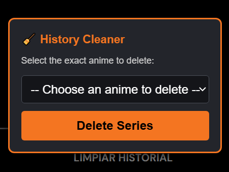
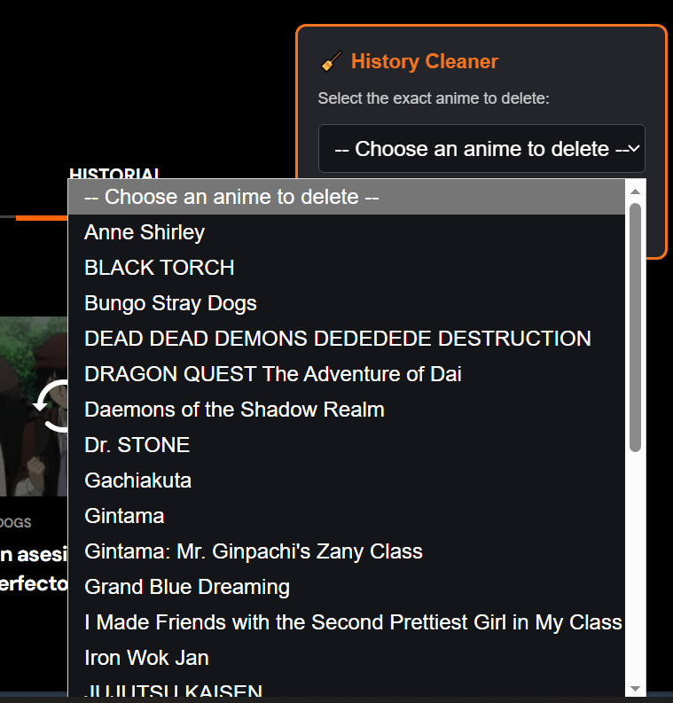

# Crunchyroll History Manager

> A lightweight browser extension to bulk-delete anime series from your Crunchyroll watch history in a single click.

<p align="center">
  
  
</p>

## Description

The main issue with Crunchyroll's watch history is the lack of a native option to bulk-delete an entire series. Currently, you are forced to either wipe your entire history completely or tediously delete episodes one by one. 

This extension solves that problem. By interacting directly with Crunchyroll's internal API, this tool fetches your entire watch history in the background and provides a clean, easy-to-use dropdown menu to delete all episodes of a specific anime in just one click.

## Features

* **One-Click Wipe:** Quickly delete an entire series from your watch history.
* **Smart API Integration:** Automatically fetches and groups your history directly from Crunchyroll's database.
* **No Typos:** Uses a dropdown menu populated with your actual history instead of a text input, preventing spelling errors.
* **Clean & Non-Intrusive UI:** A lightweight floating panel that only appears on the History page.

## Compatibility

| Browser | Status |
| :--- | :--- |
| Google Chrome | Fully Supported |
| Microsoft Edge | Fully Supported |
| Brave | Fully Supported |
| Mozilla Firefox | History panel tested; deletion/Continue Watching check pending (see below) |

## Installation 

### Chrome, Edge, and Brave

1. Download the latest `.zip` release and extract it.
2. Open your Chromium-based browser and go to the extensions manager (`chrome://extensions/`).
3. Enable **Developer mode** (usually a toggle in the top right corner).
4. Click on **Load unpacked** and select the folder where you extracted the files.
5. That's it! The extension is ready to use.

### Firefox (temporary development installation)

1. Open `about:debugging#/runtime/this-firefox`.
2. Click **Load Temporary Add-on** and select this project's `manifest.json`.
3. Sign in to Crunchyroll and open the [History page](https://www.crunchyroll.com/history) in a new tab, or reload an existing History tab.
4. Wait for **History Cleaner** to populate the series dropdown. Loading the panel only reads history; deletion requires selecting a series and confirming **Delete Series**.

The temporary extension is removed when Firefox restarts. After editing the code, click **Reload** beside the extension in `about:debugging`, then reload the Crunchyroll tab. See Mozilla's [temporary installation guide](https://extensionworkshop.com/documentation/develop/temporary-installation-in-firefox/).

The original extension's history panel was reported working in Firefox during development. Local Manifest V3 validation and mocked API/DOM tests pass for this version. Deletion and removal from Continue Watching still require a live account test; these checks do not establish end-to-end Firefox support. If loading fails, the panel displays the HTTP error when available. A rejected deletion stops processing and does not report success; earlier successful batches cannot be undone.

### Development checks

Use Node.js 22.22.2+, 24.15.0+, or 26+ (as supported by jsdom):

```sh
npm ci
npm test
npx web-ext@10.8.0 lint
```

The tests use fake credentials and history, with no requests to Crunchyroll. They cover title handling, history pagination, cookie-based authentication, deletion batching, and HTTP failures. The extension itself needs no build step or npm dependencies.

Mozilla's validator still warns that `browser_specific_settings.gecko.data_collection_permissions` is missing. The maintainer must choose an accurate declaration before a new Firefox Add-ons submission; this change does not claim marketplace readiness.

## How to Use

1. Navigate to your [Crunchyroll Watch History](https://www.crunchyroll.com/history).
2. A floating panel will appear on the right side of the screen.
3. Wait a few seconds for it to scan your database (it will say "Loading database...").
4. Select the anime you want to remove from the dropdown list.
5. Click **"Delete Series"** and confirm. The page will reload automatically once it's done!

## Disclaimer

*This extension relies on Crunchyroll's internal API. It is a fan-made tool and is not affiliated with, maintained, authorized, endorsed, or sponsored by Crunchyroll, LLC or any of its affiliates.*

## Acknowledgments & Credits

A huge shoutout to the original creator of this concept. The initial idea and the reverse-engineering of Crunchyroll's API requests were based on their original project:
* Original inspiration by: [N0amG/crunchyroll_series_remover_from_history_webextension](https://github.com/N0amG/crunchyroll_series_remover_from_history_webextension)

## License

This project is licensed under the MIT License.
